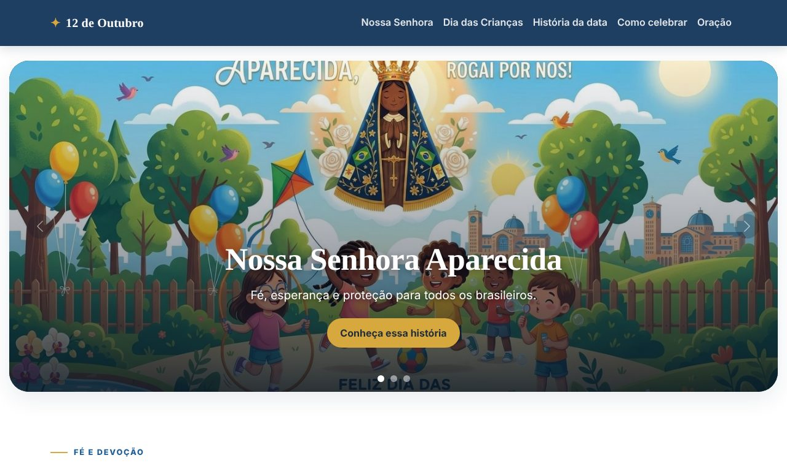

# 12 de Outubro

Página temática sobre o 12 de outubro, data em que se celebram Nossa Senhora Aparecida, padroeira do Brasil, e o Dia das Crianças. Projeto desenvolvido na disciplina de **Desenvolvimento Front-End para Web**, no curso de Engenharia de Software do UDF.

**Ver online:** https://victor-coutin.github.io/12-de-Outubro/



## O que tem no site

- Carrossel de imagens na página inicial, com chamadas para cada seção
- Menu fixo que destaca a seção que está na tela (scrollspy)
- Seções sobre Nossa Senhora Aparecida, o Dia das Crianças e a história da data
- Abas com ideias de como celebrar cada uma das datas
- Oração com botão para copiar o texto, que avisa com uma mensagem na tela
- Mensagem de boas-vindas e animação dos blocos ao rolar a página
- Layout responsivo, para computador, tablet e celular

## Tecnologias

- HTML
- CSS, com variáveis, Flexbox e media queries
- JavaScript puro (`IntersectionObserver`, área de transferência e eventos)
- Bootstrap 5 (grid, carrossel, abas, scrollspy e toasts)
- Font Awesome 6 (ícones)

## Estrutura

```
index.html            estrutura da página
style.css             estilos próprios
script.js             interações
css/bootstrap.min.css Bootstrap
img/                  imagens do carrossel
```

## Como abrir no computador

1. Baixe ou clone este repositório.
2. Dê dois cliques no `index.html`.

É preciso ter internet para carregar os ícones, as fontes e o JavaScript do Bootstrap, que vêm de CDN.
